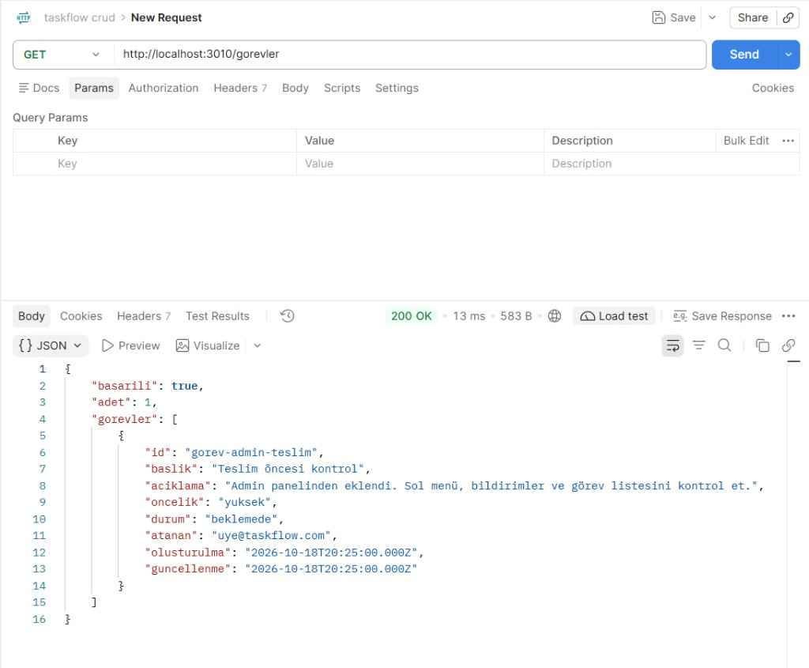
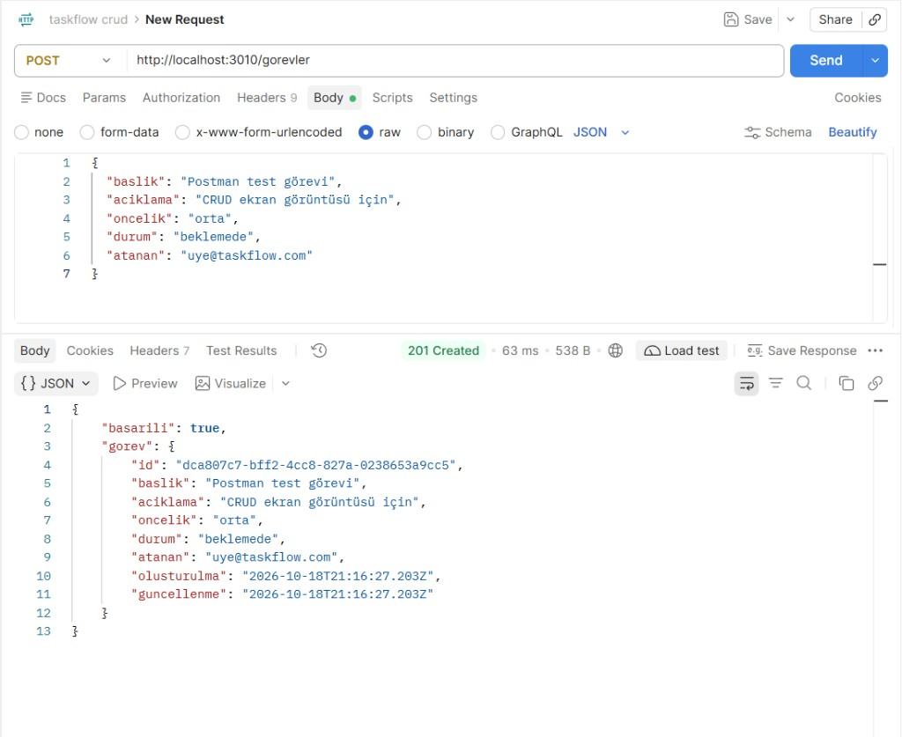
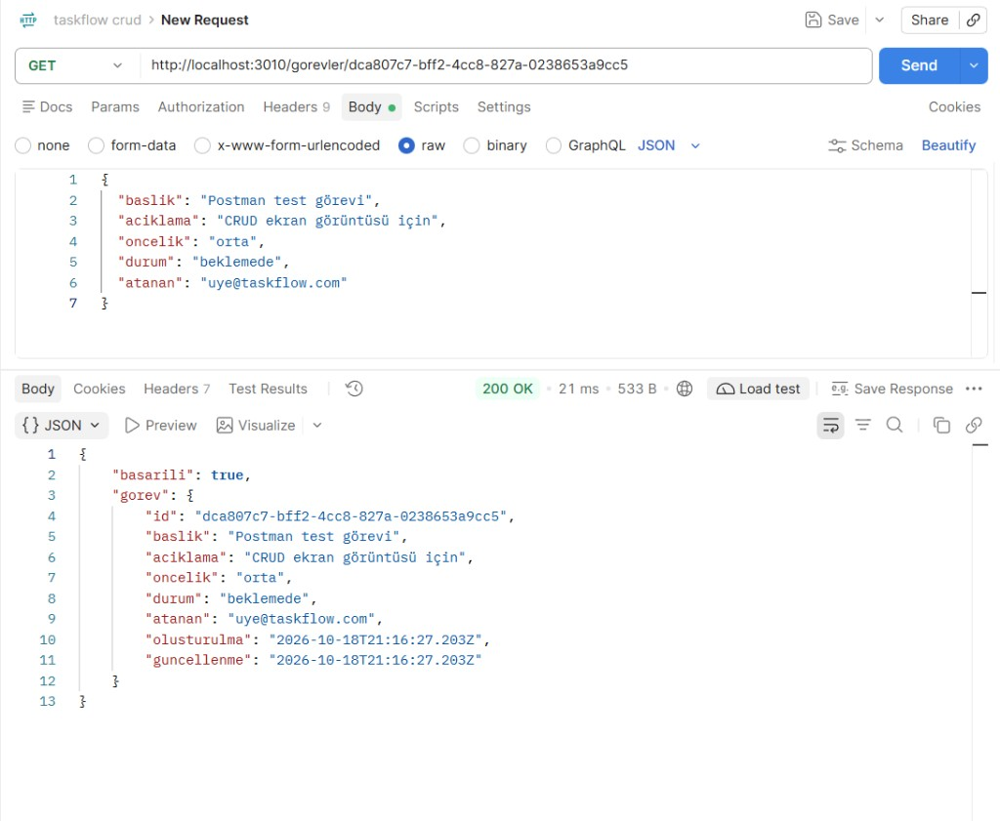
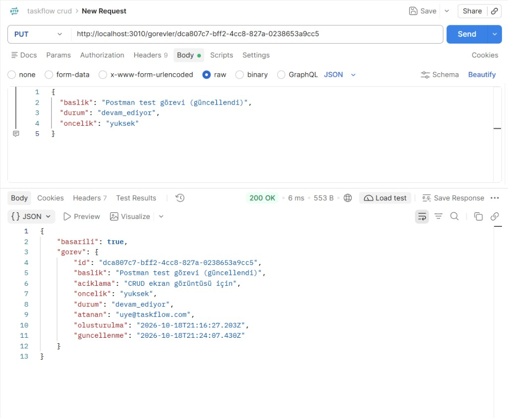
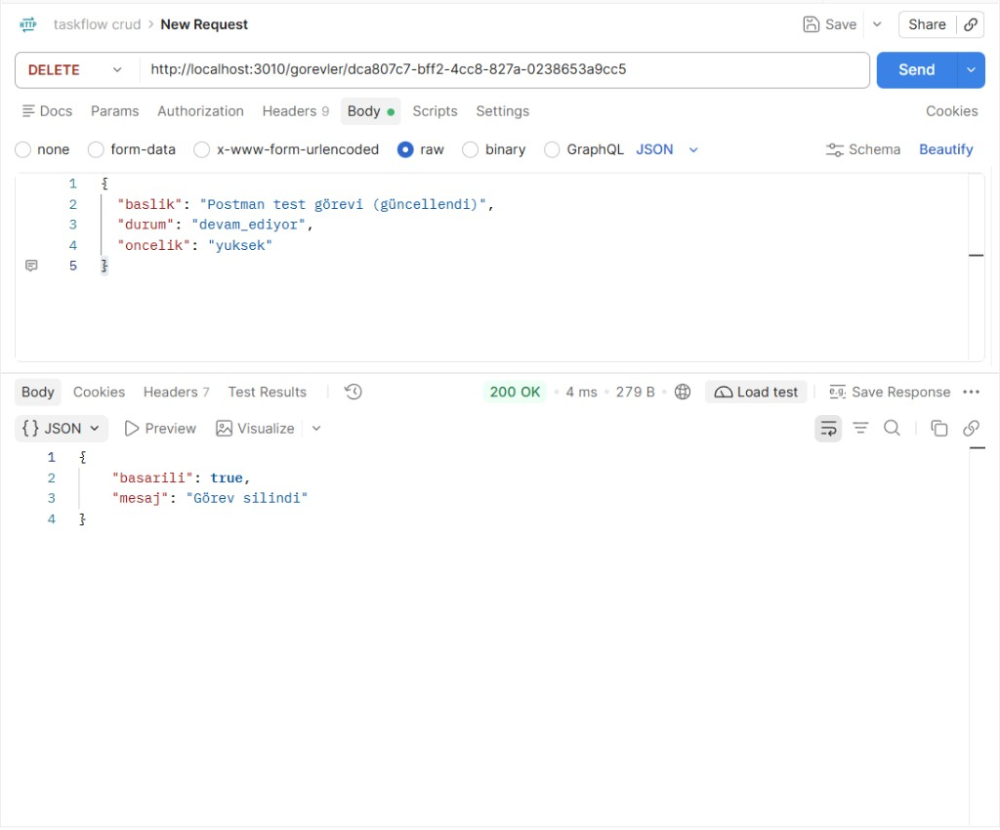

# TASKFLOW

**GitHub (public):** https://github.com/Phobothikh/taskflow

Bu, backend eğitimi için kurduğum görev sunucusu. Node.js ve Express kullanıyor. Görevler, kullanıcılar, günlük raporlar ve yemek kayıtları JSON dosyalarında duruyor. Tarayıcıda bir panel de açılıyor.

Panel: [http://localhost:3000](http://localhost:3000)

Sunucu ayakta mı diye bakmak için: [http://localhost:3000/durum](http://localhost:3000/durum)

```json
{ "basarili": true, "mesaj": "TASKFLOW API ayakta" }
```

## Yönergede benden istenenler

Eğitimde teslim etmem istenenler şunlardı. Hepsi bu depoda var.

Çalışan bir REST API kurdum. Görev eklenebiliyor, listelenebiliyor, tek tek açılabiliyor, değiştirilebiliyor ve silinebiliyor. Giriş gerekmez.

Yeni görevde başlık zorunlu. Açıklama, öncelik, durum ve atanan kişi boş kalabilir. Öncelik şunlardan biri olur: `dusuk`, `orta`, `yuksek`, `acil`. Yazılmazsa `orta` kabul edilir. Durum şunlardan biri olur: `beklemede`, `devam_ediyor`, `tamamlandi`. Yazılmazsa `beklemede` kalır. Başlık boşsa ya da öncelik ile durum bu listede yoksa sunucu 400 döner. Kayıt numarasını ve saatleri sunucu kendisi yazar.

```json
{
  "baslik": "Veritabanı şeması",
  "aciklama": "Tabloları çiz",
  "oncelik": "yuksek",
  "durum": "devam_ediyor",
  "atanan": "uye@taskflow.com"
}
```

| Ne yapıyorum | Adres | Sonuç |
|--------------|--------|--------|
| Liste | `GET /gorevler` | 200 |
| Tek görev | `GET /gorevler/:id` | 200 |
| Ekleme | `POST /gorevler` | 201 |
| Güncelleme | `PUT /gorevler/:id` | 200 |
| Silme | `DELETE /gorevler/:id` | 200 |

Kayıtlar `data/gorevler.json` dosyasındadır.

Her gelen istekte yöntem, adres ve saat yazılır. Satır terminalde görünür ve `gunluk/istekler.log` dosyasına eklenir. Günlük dosyalarını depoya koymadım.

Ayrıca kısa bir proje tanıtımı, bu kurulum notu, kaynak kod, `package.json` ve Postman ekran görüntüleri istendi. Tanıtım `docs/PROJE_TANITIM.md` içindedir. Görüntüler aşağıda.

Yönergenin nota girmeyen ileri kısmı da duruyor: süzme, arama, sayfalama, sıralama, doğrulama katmanı ve görev sayımı. Onları da ekledim. Nasıl çalıştıkları aşağıdaki başlıkta.

## Bunun dışında eklediklerim

Bunlar yönergede yoktu. Kendim ekledim.

**Giriş.** İki deneme hesabı var. İkisi de aynı ekrandan girer. Ayrı bir admin sayfası yok.

| E-posta | Şifre | Ne işe yarar |
|---------|--------|----------------|
| uye@taskflow.com | 123456 | kendi raporu ve kendi yemek kartı |
| admin@taskflow.com | admin123 | bunlara ek olarak ekibin rapor takibi |

Şifre dosyada düz durmaz, bcrypt ile saklanır. Bunlar sadece deneme içindir.

Giriş adresi `POST /giris`. Gövde:

```json
{
  "eposta": "uye@taskflow.com",
  "sifre": "123456"
}
```

Cevaptaki anahtarı sonraki istekte başlığa yazıyorum:

```
X-Oturum-Anahtari: <giris-cevabindaki-anahtar>
```

`GET /ben` giriş yapan kişiyi verir. `POST /cikis` oturumu kapatır.

**Günlük rapor.** Üye bugün ne yaptığını ve yarın ne yapacağını yazar. Engel varsa onu da ekler. Aynı gün ikinci kez yazarsa yeni rapor açılmaz, eski kayıt güncellenir. Admin, bugün kimin yazdığına bakar. Yazmayan kişiye hatırlatma gider. Üye bunu kendi ekranında görür.

| Ne | Adres | Kim |
|----|--------|-----|
| Bugünkü durum | `GET /gunluk-raporlar/bugun` | üye |
| Raporu kaydet | `POST /gunluk-raporlar` | üye |
| Ekibe bak | `GET /gunluk-raporlar/takip` | admin |
| Hatırlat | `POST /gunluk-raporlar/takip/hatirlat` | admin |

**Panel.** Soldan görevler, projeler, bildirimler, Fly Bird ve Hafıza açılır. Üstteki zil bildirim sayfasına gider. Orada rapor hatırlatması ve sabit duyurular durur.

Fly Bird yavaş bir kuş oyunu. Boruların arasından geçince skor artar. Sağda ekip sıralaması var. Skor tarayıcıda kalır.

Hafıza, aynı iki kartı bulma oyunu. En iyi hamle sayısı da tarayıcıda kalır.

**Yemek ve kahve.** Sol menünün altında bir kart var. Giriş yapan kişi bu hafta en çok ne yediğini ve en çok ne içtiğini görür. Başka birinin kaydı bu kartta çıkmaz.

Hafta İstanbul saatine göre pazartesi başlar, pazar biter. Bu aralıktaki kayıtlar sayılır. En çok yazılan yemek bir yana, en çok yazılan içecek öbür yana gelir. Dört kez mercimek çorbası ve beş kez Türk kahvesi girildiyse kartta bu ikisi yazar. Altında kısa bir cümle de vardır.

Form bugünün kaydını ekler. Yemek, içecek ya da ikisi birden yazılır. İkisi de boşsa kayıt olmaz. Ad en az 2, en fazla 40 karakter olabilir. Tarih formdan seçilmez. Sunucu bugünün İstanbul tarihini yazar. Her kayıt sayıyı bir artırır. “Türk kahvesi” ile “türk kahvesi” aynı içecek sayılır.

Kayıtlar `data/ikramlar.json` içindedir. İki adres de oturum ister.

```json
POST /ikram
{
  "yemek": "Mercimek çorbası",
  "icecek": "Türk kahvesi"
}
```

Bu haftanın özeti: `GET /ikram/hafta`

## İleri liste ve sayım

Bu bölüm yönergede vardı ama nota dahil değildi. Yine de ekledim. `GET /gorevler` adresine hiçbir soru eklenmezse liste eskisi gibi tam gelir. Paneldeki görevler bu yüzden duruyor.

Duruma göre süzmek için adresin sonuna `?durum=tamamlandi` yazılır. İngilizce karşılığı `?status=completed`. Öncelik için `?oncelik=yuksek` veya `?priority=high`. İkisi birden de yazılabilir.

Arama ayrı bir adrestir: `GET /gorevler/ara?kelime=şema`. Aynı iş `GET /gorevler/search?keyword=şema` ile de olur. Aranan kelime başlığa, açıklamaya ve atanana bakar. Büyük küçük harf fark etmez.

Bir kişiye bakmak için `GET /gorevler/atanan/uye@taskflow.com`. İngilizce yolu `GET /gorevler/assignee/musa`.

Sayfa için `?sayfa=1&limit=10`. `limit` en fazla 100 olur. Sıra için `?sirala=olusturulma`. Bu eskiden yeniye dizer. Yeniden eskiye için başına eksi konur: `?sirala=-olusturulma`. `sort=createdAt` de aynı işi görür.

Görev eklenirken ve güncellenirken logger’dan ayrı bir doğrulama katmanı çalışır. Başlık boşsa, açıklama metin değilse, öncelik listede yoksa veya atanan kişi çok uzunsa cevap 400 olur. Gövde Türkçe de olabilir, İngilizce de: `title`, `description`, `priority`, `assignee`. `priority` değeri `high` gelirse içeride `yuksek` diye saklanır.

Sayım adresleri giriş istemez. Tamamlananlar `GET /reports/completed`. Bekleyenler, yani durumu `beklemede` olanlar, `GET /reports/pending`. Genel sayım `GET /reports/summary`. Özet toplamı, üç durumu ve dört önceliği ayrı ayrı söyler. Türkçe adresler de aynı cevabı verir: `/raporlar/tamamlanan`, `/raporlar/bekleyen`, `/raporlar/ozet`.

## Nasıl çalıştırılır

Node.js 18 veya daha yenisi gerekir.

```bash
cd taskflow
npm install
npm run dev
```

Dosya değişince sunucu yeniden başlar. Bir kez açmak için `npm start` yeter.

3000 portu doluysa PowerShell’de:

```powershell
$env:PORT=3010; npm run dev
```

Panel o zaman `http://localhost:3010` olur. Aşağıdaki görüntüler de 3010 üzerinden alındı. Port verilmezse sunucu 3000 kullanır.

## Postman görüntüleri

Sunucu açıkken Postman’e şu iki dosya aktarılır:

- `postman/TASKFLOW.postman_collection.json`
- `postman/TASKFLOW-Yerel.postman_environment.json`

Sağ üstten **TASKFLOW Yerel** seçilir. `temel_url` sunucunun adresidir.

Beş görüntüyü sırayla çektim: liste, ekleme, tek görev, güncelleme, silme.

### 1. Listeleme

`GET /gorevler` — 200



### 2. Ekleme

`POST /gorevler` — 201



### 3. Tek görev

`GET /gorevler/:id` — 200



### 4. Güncelleme

`PUT /gorevler/:id` — 200



### 5. Silme

`DELETE /gorevler/:id` — 200



Tıklama sırası `docs/POSTMAN.md` içinde. Adres listesi `docs/API_TASARIM.md` içinde. Görev alanları `docs/VERI_MODELI.md` içinde.

## Dosyalar

```
src/sunucu.js         program buradan başlar
src/uygulama.js       Express ayarı
src/rotalar/          adresler
src/denetleyiciler/   isteğe verilen cevap
src/servisler/        JSON dosyasını okuyup yazan kısım
src/araKatman/        istek günlüğü ve görev doğrulaması
public/               panel
data/                 JSON kayıtlar
postman/              Postman dosyaları
docs/                 tanıtım, API notu, ekran görüntüleri
```
